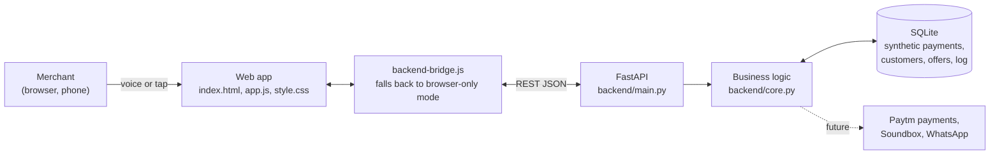

# Paytm Business Autopilot

**A voice-first AI teammate for India's small shops. Every evening it finds one useful action, asks the merchant in their own language, and then proves whether it actually made money.**

Built for the **Paytm Build for India AI Hackathon, Bengaluru (2026)**. Tracks: Merchant Growth AI and Autonomous AI Teammates.

> Concept prototype built for the hackathon, not an official Paytm product. All merchant and customer data in this repository is synthetic. No real messages or payments are sent.

<!-- Add screenshots here, for example:

-->

---

## The problem

A kirana owner does not want another dashboard. They are at the counter all day, often more comfortable in Hindi or Kannada than English, and they have no time to study charts. Yet their payment history already shows which regular customers have quietly stopped coming, and which days are slow.

Most "AI for merchants" ideas are chatbots or analytics screens. They tell the merchant things. They do not act, and they never prove that their advice worked.

## The idea

At closing time, the merchant hears one short briefing on their Paytm Soundbox or WhatsApp:

> "Meera, 14 regular customers have not returned in 3 weeks. Should I send a ₹20 offer to 7 of them and hold back 7 to measure fairly?"

They say **"haan"** or tap once. The agent sends the offer only to customers who agreed to receive offers, holds back a comparison group, and a week later reports the real extra revenue, after subtracting the customers who would have come back anyway and the cost of the discount.

```
Detect  ->  Calculate  ->  Ask  ->  Measure
```

| Step | What happens |
|---|---|
| **Detect** | Payment recency and frequency find regular customers who are outside their usual return window. Seasonal visitors are skipped on purpose. |
| **Calculate** | A visible formula predicts the net gain: `offer customers × (offer return rate − natural return rate) × average bill − discount cost`. |
| **Ask** | A voice briefing in English, Hindi or Kannada. The merchant approves by voice or one tap, and can undo. |
| **Measure** | The offer group is compared with a held-back control group. The agent reports measured lift, not every sale it can claim, and updates its own expectations up or down. |

## What makes it different

- **Measured outcomes, not conversations.** Every recommendation shows its formula, and every result is measured against a control group.
- **Voice-first and vernacular.** Built around a merchant who is busy at the counter, not someone sitting at a laptop.
- **Consent by design.** Only customers who opted in can be contacted, with a once-per-30-days limit, quiet hours after 9 PM, and a discount cap.
- **Knows when to say no.** It skips discounts for seasonal customers, because a discount would pay for visits that happen anyway.
- **Earns autonomy.** It asks every time by default. The merchant can let it act on its own, but only inside their rules.
- **Fully auditable.** Every signal, decision and outcome goes into an activity log, with who did it (Agent or Merchant).

## Demo story

The synthetic store is **Meera Stores, Whitefield, Bengaluru**: 200 customers and about 2,000 payments. The same story loads after every reset.

| | Numbers |
|---|---|
| Tonight's briefing | 14 eligible customers: 7 get the offer, 7 held back |
| Prediction | 7 × (35% − 10%) × ₹500 − ₹49 discount = **₹826 net** |
| Last week's measured result | 3 of 7 came back with the offer, 1 of 7 came back on their own: ₹1,500 − ₹500 − ₹60 = **₹940 net** |
| Skipped on purpose | 6 seasonal customers |

**Try this:** approve the offer, then click **Fast-forward 3 weeks**. The new result comes in at 2 of 7 vs 1 of 7 (about ₹490), below the prediction, so the agent lowers its expected return rate from 35% to 30%. It learns in both directions.

## Features

- **Tonight:** voice briefing with real speech playback and "haan" voice approval, a visible formula, a consent check, a WhatsApp preview of the customer message, and measured results.
- **Customers:** payment-derived segments (lapsed regular, active regular, seasonal, new), search, sorting, consent states, and send to selected customers with review and undo.
- **Results:** offer group and control group, with message statuses from sent to came back.
- **Agent rules:** autonomy setting and guardrails.
- **Log:** a complete trail of what the agent saw, decided and did.
- **Profile:** store details that change the agent's behaviour. Closing time moves the briefing time, and the weekly day off is removed from slow-day analysis. Also shows what the agent has learned, with a reset.
- **Languages:** the whole interface in English, हिन्दी and ಕನ್ನಡ.
- **Demo controls:** fast-forward, new week and reset (press `D`).
- **Resilient:** if the backend is not running, the app keeps working in browser-only mode.

## Architecture



- **Frontend:** plain HTML, CSS and JavaScript with no build step. It uses the browser's Web Speech API for voice playback and recognition.
- **Backend:** Python, FastAPI and SQLite, using only the standard library for the logic. All numbers are computed from the payments table: segments, eligibility, predictions, measured lift, weekly metrics and the slow day.
- **Demo clock:** the backend has its own clock, so fast-forward ages the whole store consistently.

## Tech stack

| Layer | Technology |
|---|---|
| Frontend | HTML, CSS, vanilla JavaScript, Web Speech API |
| Backend | Python 3.10+, FastAPI, Uvicorn |
| Database | SQLite |
| Fonts | Anek (Latin, Devanagari, Kannada) by Ek Type, with system fallbacks |
| Hosting (optional) | Render (`render.yaml` included) |

## Quick start

You need Python 3.10 or newer.

```bash
git clone <your-repo-url>
cd <repo-folder>

python -m venv .venv
# Windows
.\.venv\Scripts\Activate.ps1
# macOS / Linux
source .venv/bin/activate

pip install -r backend/requirements.txt
python -m uvicorn backend.main:app --reload
```

Open **http://localhost:8000** for the app and **http://localhost:8000/docs** for the interactive API documentation.

Run uvicorn from the project root (the folder that contains `index.html`), not from inside `backend`. The database is created and seeded automatically on first start.

**Without the backend:** open `index.html` directly, or serve the folder with any static server. The app runs in browser-only demo mode.

Detailed Windows setup and troubleshooting are in [BACKEND-GUIDE.md](BACKEND-GUIDE.md).

## API overview

All write endpoints return the full updated app state, so the screen refreshes in one round trip.

| Method | Endpoint | Purpose |
|---|---|---|
| GET | `/api/health` | Health check |
| GET | `/api/state` | Everything the app needs in one call |
| GET | `/api/briefing` | Tonight's eligible customers, formula and briefing text |
| GET | `/api/customers` | Customers with filters, search, sorting and pages |
| GET | `/api/customers/{id}` | Customer detail with payments and messages |
| POST | `/api/customers` | Add a customer (Indian mobile validation, duplicate check) |
| POST | `/api/customers/{id}/confirm-consent` | Customer replied YES |
| POST | `/api/customers/simulate-join` | Simulate a customer tapping Join after paying |
| DELETE | `/api/customers/{id}` | Remove a customer's data |
| POST | `/api/experiments` | Approve tonight's offer (tap, voice or autopilot) |
| POST | `/api/experiments/{id}/cancel` | Cancel within the undo window |
| GET | `/api/experiments`, `/api/results/latest` | Offers and measured results |
| POST | `/api/messages/send`, `/api/messages/undo` | Send to selected customers, and undo |
| GET, PATCH | `/api/profile` | Store profile and agent rules |
| POST | `/api/profile/reset-learning` | Reset what the agent learned |
| GET | `/api/log` | Activity log |
| POST | `/api/demo/fast-forward`, `/api/demo/new-week`, `/api/demo/reset` | Demo controls |

## Project structure

```
.
├── index.html            App shell
├── app.js                Frontend logic, translations, voice
├── style.css             Design system (Paytm navy and sky)
├── backend-bridge.js     Connects the app to the API, with offline fallback
├── backend/
│   ├── main.py           FastAPI routes
│   ├── core.py           Segments, briefing, offers, measurement, learning
│   ├── seed.py           Deterministic synthetic store
│   ├── db.py             SQLite schema and helpers
│   ├── smoke_test.py     End-to-end check of a running server
│   ├── tests/            Logic tests
│   └── requirements.txt
├── render.yaml           Optional one-click deploy
└── BACKEND-GUIDE.md      Step-by-step setup guide
```

## Testing

```bash
# Logic tests (no server needed)
python -m unittest backend.tests.test_core -v

# End-to-end check against a running server (resets demo data at the end)
python backend/smoke_test.py
python backend/smoke_test.py https://your-app.onrender.com
```

## Deploy (optional)

1. Push this repository to GitHub.
2. On [Render](https://render.com), choose **New > Blueprint** and select the repository. `render.yaml` configures everything.
3. Open the `onrender.com` link. The app and API are served from the same address.

The free plan sleeps when idle, so open the link a couple of minutes before a demo. The SQLite database resets on restart and reseeds the same story.

## What is real and what is simulated

| Real in this prototype | Simulated |
|---|---|
| Segment, eligibility and prediction calculations | Customers and payments (synthetic, deterministic) |
| Control-group measurement and learning | WhatsApp delivery and customer replies |
| Consent rules, contact limits, quiet hours, discount cap | Soundbox delivery |
| Voice playback and recognition (browser Web Speech API) | Payment support tickets |
| Persistence, API and audit log | Customer behaviour after an offer (based on expected rates) |

## Roadmap

- WhatsApp Business messages to opted-in customers, using approved templates
- Briefings delivered through Paytm Soundbox
- Merchant sign-in, so each merchant sees only their own store
- Scheduled evening agent runs
- Learning across many merchants, so one store's small sample is backed by thousands of experiments
- Working-capital suggestions based on cash-flow patterns

## Team

Add your team members here.

---

Built for the Paytm Build for India AI Hackathon, Bengaluru, 2026.
